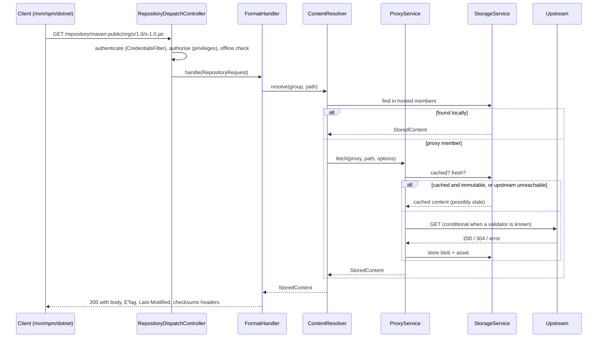

# Architecture

Granary is a single Spring Boot process with a small, format-agnostic core and one module per
package format. Everything a client can do goes through two HTTP surfaces:

* `/repository/{name}/**`: the native protocol of the repository's format. Package managers
  talk only to this.
* `/api/v1/**`: a JSON REST API used by the web UI and by automation.

A few protocols insist on fixed URLs at the server root (Docker's `/v2/`, Terraform's
`/.well-known/terraform.json`); their format claims those requests and the server forwards them
to `/repository/{name}/…` (see [Root routing](#root-routing)).

## Modules

| Module | Responsibility |
|--------|----------------|
| `granary-core` | Domain model (repositories, components, assets, users, roles, tokens, settings), the content-addressed blob store and its compaction, `StorageService` with its write locks, the offline-first `ProxyService`, hosted/proxy/group resolution, security services and the format SPI. No HTTP framework code except the servlet request/response types handed to format handlers. |
| `granary-format-maven` | Maven 2 (`maven2`): path parsing, version ordering, `maven-metadata.xml` generation and merging, checksum sidecars, snapshot handling, release/snapshot policies. |
| `granary-format-npm` | npm (`npm`): packuments, tarballs, publish, dist-tags, deprecation, scoped packages, `npm login` tokens. |
| `granary-format-nuget` | NuGet V3 (`nuget`): service index, registration, package content, search, push, delete, symbol packages, API-key authentication. |
| `granary-format-pypi` | PyPI (`pypi`): simple index (PEP 503/691) with metadata sidecars, legacy upload API, JSON API. |
| `granary-format-docker` | Docker / OCI (`docker`): Distribution API v2 / OCI 1.1, uploads, manifests, referrers, token-based upstreams, root routing for `/v2/`. |
| `granary-format-go` | Go modules (`go`): GOPROXY protocol, module zip checks, checksum database passthrough. |
| `granary-format-cargo` | Cargo (`cargo`): sparse index and registry web API (publish, yank, owners, search). |
| `granary-format-helm` | Helm (`helm`): chart repositories with `index.yaml` and the ChartMuseum API. |
| `granary-format-terraform` | Terraform / OpenTofu (`terraform`): service discovery (root routed), provider and module registries, network mirror. |
| `granary-format-conan` | Conan (`conan`): Conan v2 REST API with revisions, search, token login. |
| `granary-format-hex` | Hex (`hex`): signed registry documents, release tarballs, the Hex HTTP API used by mix and rebar3. |
| `granary-format-composer` | Composer (`composer`): Composer 2 metadata, dist archives, search, advisories. |
| `granary-format-pub` | pub (`pub`): Hosted Pub Repository Specification v2. |
| `granary-format-swift` | Swift (`swift`): Swift Package Registry Service (SE-0292/SE-0321). |
| `granary-format-rubygems` | RubyGems (`rubygems`): `gem push`, compact index, Marshal indexes, JSON API. |
| `granary-format-cocoapods` | CocoaPods (`cocoapods`): CDN-style spec repositories and source archive caching. |
| `granary-format-raw` | Eight file-oriented formats sharing one implementation: `raw`, `cdn`, `cpan`, `cran`, `hackage`, `vcpkg`, `bower`, `elm`. |
| `granary-ui` | Vue 3 single-page application built with Vite, packaged as static resources. |
| `granary-server` | The executable: Spring Security filter chain, root routing filter, repository dispatcher, REST controllers, SPA fallback, database migrations, Docker packaging. |

Each format's protocol details are in [docs/formats](formats/README.md).

## Request flow



## The format SPI

A format is a Spring bean implementing `dev.granary.core.format.FormatHandler`:

```java
public interface FormatHandler {
    String format();                       // "maven2", "npm", "docker", …
    String displayName();
    default Set<RepositoryType> supportedTypes() { … }       // all three unless restricted (vcpkg: hosted only)
    default void validate(Repository repository) { … }       // format rules, including its formatSettings
    default AccessLevel requiredAccess(RepositoryRequest request) { … } // READ, WRITE or NONE per request
    default boolean isMetadataPath(String path) { … }        // mutable index documents vs immutable artifacts
    ResponseEntity<?> handle(RepositoryRequest request) throws IOException;

    default List<RepositoryTemplate> templates() { … }                      // standard repositories
    default List<ConnectSnippet> connectSnippets(ConnectContext context) { … } // client configuration
    default List<SettingDescriptor> settings() { … }                        // format-specific settings
    default Optional<RootRoute> routeRoot(RootRequest request) { … }        // claims for root URLs
}
```

The dispatcher decodes and normalises the path (refusing `..` segments, backslashes, NUL
characters and over-long paths with `400 path.invalid`), checks the privilege the handler asks
for, and hands over the request. Handlers use `ContentResolver` for the common cases (a file that
lives in hosted storage or the proxy cache, possibly through a group) and drop down to
`ProxyService` and `StorageService` directly when the format needs to merge or rewrite documents
(npm packuments, Maven metadata, NuGet registration pages, Cargo index files, Helm indexes, …).

The last four methods ([ADR 0011](adr/0011-format-spi-v2.md)) let a format ship everything around
its protocol as well:

* **Templates** (`RepositoryTemplate`: name, format, type, remote URL, version policy, members,
  description, format settings) are the format's standard repositories, members before groups.
  `POST /api/v1/repositories/standard` creates every installed format's templates whose name is
  still free.
* **Connect snippets** (`ConnectSnippet`: id, title, language, file name, code) are rendered per
  repository by `GET /api/v1/repositories/{name}/connect` from a `ConnectContext` holding the
  repository URL, the server root, the caller's user name and the placeholder `<api-token>`. The
  UI's *Connect* panel only displays them.
* **Settings** (`SettingDescriptor`: key, label, type, default, description, applicable repository
  types) describe the keys a repository may carry in its `formatSettings` map, stored as JSON text
  in `repositories.format_settings`. `GET /api/v1/formats` publishes them with the supported types
  and template names, and the UI builds its repository form from that. Values are strings; the
  handler's `validate` checks them. Core adds its own settings there (`FormatRegistry.settings`):
  `upstream.credentialHosts` for every format with proxy repositories, checked by core's repository
  validation. Every key is listed in [configuration.md](configuration.md#format-settings).
* **Root routes** are described below.

Adding a format therefore means one new Maven module, one handler bean and tests. The core,
the security model, the UI's repository screens and the REST API pick it up through
`FormatRegistry`. The raw module shows that one module may register several handlers (eight
format ids) that share an implementation.

## Root routing

`RootRouteFilter` runs right after the security filters for every request outside `/repository/`,
`/api/`, `/actuator/` and the UI's assets. It asks each handler's `routeRoot` and forwards the first
claim to `/repository/{name}/{path}`, with the request attribute `RootRoute.ATTRIBUTE` holding the
original root path, so the dispatcher authorises it like any repository request and the handler
can write root-relative URLs ([ADR 0012](adr/0012-root-routing.md)):

* Docker claims `/v2/…`: `/v2/<repository>/<image>/…` goes to that docker repository, everything
  else to the root repository (`docker.rootRepository`, else the first docker group, else the
  first docker repository by name).
* Terraform claims `GET`/`HEAD /.well-known/terraform.json` for the repository flagged
  `terraform.rootRepository` (else the first Terraform group, else the first Terraform repository);
  the discovery document points the CLIs at that repository's `/repository/<name>/v1/…` services.

Unclaimed requests continue to the web UI.

## Storage

* **Blobs** are stored once, by SHA-256, under `<data-dir>/blobs/content/ab/cd/<hash>` (the
  `default` store; other stores use their configured directory, or `<data-dir>/blobs-<name>`).
  Writes go to a temporary file and are moved into place atomically, so a crash never leaves a
  half-written blob visible. Identical content from different repositories or uploads shares one
  file.
* **Assets** (one row per path in a repository) and **components** (the logical package a
  group of assets belongs to, e.g. `org.x:x:1.0` or `@scope/pkg@1.2.3`) live in the relational
  database and reference blobs by hash. Deleting assets, components or repositories removes
  rows only; `BlobCompactionService` later deletes the blobs nothing references any more and
  that are older than a grace period, on a schedule or on demand
  (`POST /api/v1/blob-stores/{name}/compact`). A write keeps its blob pinned from the moment
  it is placed until its asset row is committed, and storing bytes that already exist refreshes
  the blob's modification time, both under a per-blob lock that compaction's final checks and
  delete take too, so compaction never deletes a blob that an upload in progress is about to
  reference, whatever the grace period.
* Multiple named blob stores can be configured (`granary.storage.blob-stores.<name>.path`) and assigned per
  repository, for example to put large Docker layers on a different disk later. A repository's
  blob store is fixed once it holds content.
* **Concurrent writes** of the same path or the same component are serialised by
  `StorageLocks`: one in-JVM lock per asset path and per component coordinates, taken path
  first, held until the transaction that wrote the row has committed (released in
  `TransactionSynchronization.afterCompletion`) and waited for at most
  `granary.storage.write-lock-timeout`. For an asset the last writer wins; concurrent creators
  of a component all end up linked to the same row. `StorageService.store` writes the blob and
  waits for the lock before it opens its transaction, so no database connection is held during
  an upload. Every write waits for its path lock before it opens its transaction and for a
  component lock only inside it, so a thread holding a pooled connection never waits for a
  thread that waits for one. The unique constraints stay as the last line of defence: a constraint violation,
  optimistic-locking failure or lock time-out that still escapes is answered with
  `409 storage.conflict` instead of `500`.
* Values from upstream responses are sanitised before they are stored (`AssetSanitiser`):
  `Content-Type` is cleaned or guessed from the path, over-long or malformed `ETag` and
  `Last-Modified` values are dropped, and paths longer than 2,000 characters (or 2,600 bytes in
  UTF-8, the most PostgreSQL can put in the unique index) are refused with `400 path.invalid`.

## Offline-first proxying

`ProxyService.fetch(repo, path, options)` implements one policy for every format:

1. **Immutable content** (anything the format says is not metadata) is returned from cache
   without touching the network, forever. Package managers rely on this being safe and so does
   Granary.
2. **Mutable documents** (index files) are returned from cache while younger than the
   repository's *metadata max age*. After that, one conditional request (`If-None-Match` /
   `If-Modified-Since`) is attempted. `304` refreshes the cache's timestamp, `200` replaces the
   document, anything else serves the stale copy and records a failure.
3. **Failures** are counted per repository in `UpstreamHealth`. After *failure threshold*
   consecutive failures the breaker opens for 30 s, doubling up to 10 min. While open, exactly
   one request is allowed through as a probe; everyone else gets cached data or a `503`.
4. **Negative results** (`404`) are remembered for *negative cache TTL* so that a missing
   artifact asked for by a hundred builds costs one upstream request.
5. A repository's own **offline switch** and the global **offline mode** short-circuit all of
   the above: cached or nothing.
6. **Single flight**: concurrent requests for the same uncached or stale file of one repository
   cause one upstream request. The first caller fetches and stores; the others wait (at most
   `granary.proxy.single-flight-timeout`, interruptibly) until its write has committed and
   then read the cached copy. If the fetch fails they retry once, and a waiter that times out
   fetches on its own. Nothing is kept per path once its fetch is over. A fetch made inside a
   caller's own transaction does not take part: its write is invisible until that transaction
   commits, and waiting would hold the transaction's connection.
7. **Components**: the format passes the coordinates of the file (`FetchOptions.component`),
   the same ones a hosted upload of it records, and the cached asset is stored linked to that
   component in the same transaction, so the component browser, search and component deletion
   treat cached and hosted content alike. A cached file that is still unlinked (cached before
   0.2.0) is linked when it is next served, offline too. Metadata carries no coordinates, groups
   store nothing, and coordinates the components table cannot hold are dropped rather than
   failing the download.

## Security

`CredentialsFilter` turns whatever credential the client sent (HTTP Basic with a password or
a token, `Authorization: Bearer` with a token or a web session JWT, `Authorization: Token <token>`,
a bare `gry_…` token as the whole `Authorization` value as cargo, `gem` and `mix` send it,
`X-NuGet-ApiKey` or `X-Api-Key`) into a `GranaryPrincipal` holding the flattened set of
privileges. Invalid credentials are answered with `401` right away; requests without credentials
continue as the anonymous user. The filter chain only decides what anonymous callers may reach;
fine-grained checks happen in the dispatcher (per repository and per read/write, as reported by
the format handler) and with `@PreAuthorize` on the API. There is
no HTTP session: every request is authenticated on its own. Write coordination (per-path and
per-component locks, proxy single flight, compaction) lives in the JVM, however, so Granary runs
as a single node; see [ADR 0010](adr/0010-single-node-write-coordination.md).

## Database

Flyway migrations in `granary-core/src/main/resources/db/migration` are written in portable SQL
and run on H2 (PostgreSQL compatibility mode) and PostgreSQL. H2 in `AUTO_SERVER` mode is the
zero-configuration default; PostgreSQL is a profile switch. `V1` creates the schema, `V2` adds the
`format_settings` column of repositories.

## Web UI

The UI is a Vue 3 application (Pinia stores, vue-router, vue-i18n) with five locales. English
is the default; Persian switches the document to right-to-left. The build output is copied into
the server jar under `/static`, and `SpaConfig` serves `index.html` for every path that is not
an API, repository, actuator or real asset path, so deep links survive a refresh.

The UI holds no protocol knowledge: the repository form is built from `GET /api/v1/formats`
(supported types, setting editors, templates) and the *Connect* panel shows the snippets the server
renders for the repository and the signed-in user. Format names and setting labels and
descriptions arrive in English; the locale files keep translations of them under `formatText`, and
anything without a translation (a format or setting added later) is shown in English.
`FormatTextCatalogueTest` in `granary-server` fails the build when the English copy in `en.json`
and the server's texts drift apart.
