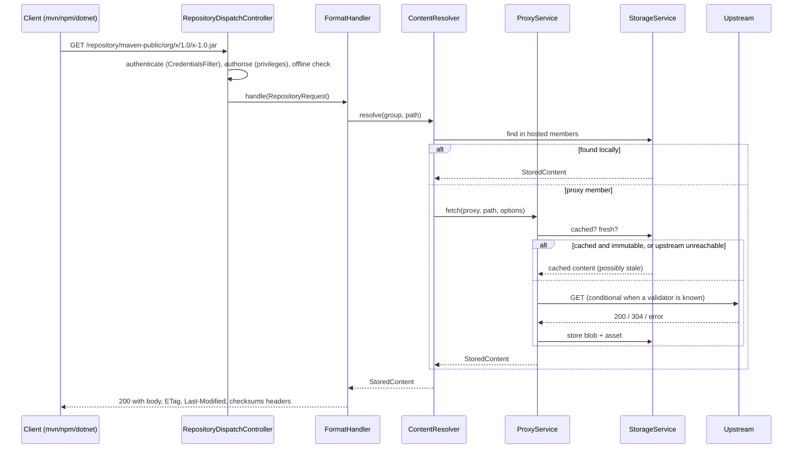

# Architecture

Granary is a single Spring Boot process with a small, format-agnostic core and one module per
package format. Everything a client can do goes through two HTTP surfaces:

* `/repository/{name}/**`: the native protocol of the repository's format. Package managers
  talk only to this.
* `/api/v1/**`: a JSON REST API used by the web UI and by automation.

## Modules

| Module | Responsibility |
|--------|----------------|
| `granary-core` | Domain model (repositories, components, assets, users, roles, tokens, settings), the content-addressed blob store, `StorageService`, the offline-first `ProxyService`, hosted/proxy/group resolution, security services and the format SPI. No HTTP framework code except the servlet request/response types handed to format handlers. |
| `granary-format-maven` | Maven 2 layout: path parsing, version ordering, `maven-metadata.xml` generation and merging, checksum sidecars, snapshot handling, release/snapshot policies. |
| `granary-format-npm` | npm registry protocol: packuments, tarballs, publish, dist-tags, deprecation, scoped packages, `npm login` tokens. |
| `granary-format-nuget` | NuGet V3: service index, registration, package content, search, push, delete/unlist, API-key authentication. |
| `granary-ui` | Vue 3 single-page application built with Vite, packaged as static resources. |
| `granary-server` | The executable: Spring Security filter chain, repository dispatcher, REST controllers, SPA fallback, database migrations, Docker packaging. |

## Request flow



## The format SPI

A format is a Spring bean implementing `dev.granary.core.format.FormatHandler`:

```java
public interface FormatHandler {
    String format();                       // "maven2", "npm", "nuget"
    String displayName();
    AccessLevel requiredAccess(RepositoryRequest request); // READ or WRITE, decided per request
    boolean isMetadataPath(String path);   // mutable index documents vs immutable artifacts
    ResponseEntity<?> handle(RepositoryRequest request) throws IOException;
}
```

The dispatcher decodes the path, checks the privilege the handler asks for, and hands over the
request. Handlers use `ContentResolver` for the common cases (a file that lives in hosted
storage or the proxy cache, possibly through a group) and drop down to `ProxyService` and
`StorageService` directly when the format needs to merge or rewrite documents (npm packuments,
Maven metadata, NuGet registration pages).

Adding a format therefore means one new Maven module, one handler bean and tests. The core,
the security model, the UI's repository screens and the REST API pick it up through
`FormatRegistry`.

## Storage

* **Blobs** are stored once, by SHA-256, under `<data-dir>/blobs/default/content/ab/cd/<hash>`.
  Writes go to a temporary file and are moved into place atomically, so a crash never leaves a
  half-written blob visible. Identical content from different repositories or uploads shares one
  file.
* **Assets** (one row per path in a repository) and **components** (the logical package a
  group of assets belongs to, e.g. `org.x:x:1.0` or `@scope/pkg@1.2.3`) live in the relational
  database and reference blobs by hash. Deleting assets, components or repositories removes
  rows only; `BlobCompactionService` later deletes the blobs nothing references any more and
  that are older than a grace period, on a schedule or on demand
  (`POST /api/v1/blob-stores/{name}/compact`). A write keeps its blob pinned from the moment
  it is placed until its asset row is committed, and storing bytes that already exist refreshes
  the blob's modification time, both under a per-blob lock that compaction's final checks and
  delete take too, so compaction never deletes a blob that an upload in progress is about to
  reference, whatever the grace period.
* Multiple named blob stores can be configured (`granary.storage.blob-stores`) and assigned per
  repository, for example to put large Docker layers on a different disk later. A repository's
  blob store is fixed once it holds content.
* **Concurrent writes** of the same path or the same component are serialised by
  `StorageLocks`: one in-JVM lock per asset path and per component coordinates, taken path
  first, held until the transaction that wrote the row has committed (released in
  `TransactionSynchronization.afterCompletion`) and waited for at most
  `granary.storage.write-lock-timeout`. For an asset the last writer wins; concurrent creators
  of a component all end up linked to the same row. `StorageService.store` writes the blob and
  waits for the lock before it opens its transaction, so no database connection is held during
  an upload. Every write waits for its path lock before it opens its transaction and for a
  component lock only inside it, so a thread holding a pooled connection never waits for a
  thread that waits for one. The unique constraints stay as the last line of defence: a constraint violation,
  optimistic-locking failure or lock time-out that still escapes is answered with
  `409 storage.conflict` instead of `500`.
* Values from upstream responses are sanitised before they are stored (`AssetSanitiser`):
  `Content-Type` is cleaned or guessed from the path, over-long or malformed `ETag` and
  `Last-Modified` values are dropped, and paths longer than 2,000 characters (or 2,600 bytes in
  UTF-8, the most PostgreSQL can put in the unique index) are refused with `400 path.invalid`.

## Offline-first proxying

`ProxyService.fetch(repo, path, options)` implements one policy for every format:

1. **Immutable content** (anything the format says is not metadata) is returned from cache
   without touching the network, forever. Package managers rely on this being safe and so does
   Granary.
2. **Mutable documents** (index files) are returned from cache while younger than the
   repository's *metadata max age*. After that, one conditional request (`If-None-Match` /
   `If-Modified-Since`) is attempted. `304` refreshes the cache's timestamp, `200` replaces the
   document, anything else serves the stale copy and records a failure.
3. **Failures** are counted per repository in `UpstreamHealth`. After *failure threshold*
   consecutive failures the breaker opens for 30 s, doubling up to 10 min. While open, exactly
   one request is allowed through as a probe; everyone else gets cached data or a `503`.
4. **Negative results** (`404`) are remembered for *negative cache TTL* so that a missing
   artifact asked for by a hundred builds costs one upstream request.
5. A repository's own **offline switch** and the global **offline mode** short-circuit all of
   the above: cached or nothing.
6. **Single flight**: concurrent requests for the same uncached or stale file of one repository
   cause one upstream request. The first caller fetches and stores; the others wait (at most
   `granary.proxy.single-flight-timeout`, interruptibly) until its write has committed and
   then read the cached copy. If the fetch fails they retry once, and a waiter that times out
   fetches on its own. Nothing is kept per path once its fetch is over. A fetch made inside a
   caller's own transaction does not take part: its write is invisible until that transaction
   commits, and waiting would hold the transaction's connection.

## Security

`CredentialsFilter` turns whatever credential the client sent (HTTP Basic with a password or
a token, `Authorization: Bearer` with a token or a web session JWT, `X-NuGet-ApiKey`) into a
`GranaryPrincipal` holding the flattened set of privileges. The filter chain only decides what
anonymous callers may reach; fine-grained checks happen in the dispatcher (per repository and
per read/write, as reported by the format handler) and with `@PreAuthorize` on the API. There is
no HTTP session: every request is authenticated on its own. Write coordination (per-path and
per-component locks, proxy single flight, compaction) lives in the JVM, however, so Granary runs
as a single node; see [ADR 0010](adr/0010-single-node-write-coordination.md).

## Database

Flyway migrations in `granary-core/src/main/resources/db/migration` are written in portable SQL
and run on H2 (PostgreSQL compatibility mode) and PostgreSQL. H2 in `AUTO_SERVER` mode is the
zero-configuration default; PostgreSQL is a profile switch.

## Web UI

The UI is a Vue 3 application (Pinia stores, vue-router, vue-i18n) with five locales. English
is the default; Persian switches the document to right-to-left. The build output is copied into
the server jar under `/static`, and `SpaConfig` serves `index.html` for every path that is not
an API, repository, actuator or real asset path, so deep links survive a refresh.
